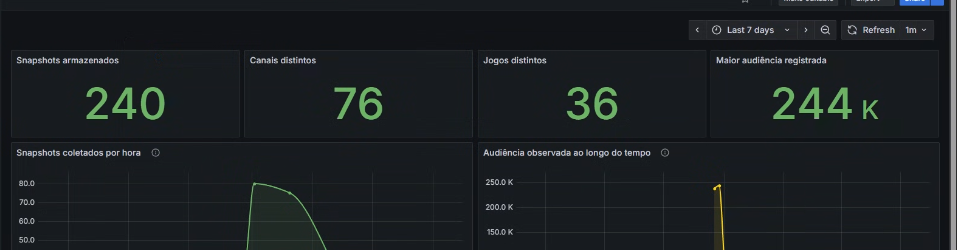
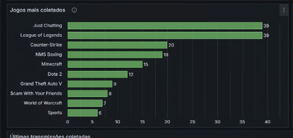
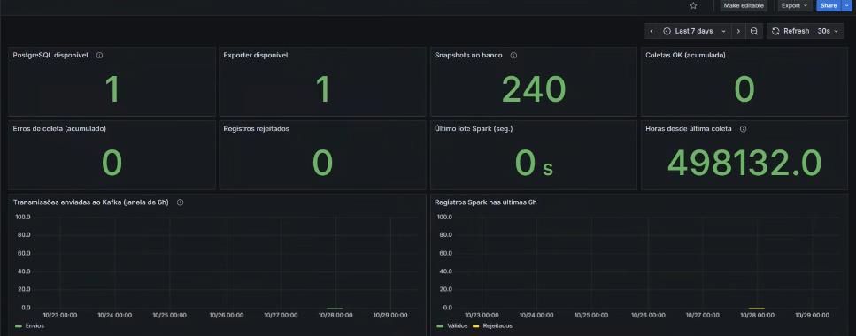
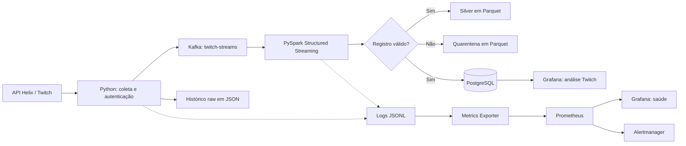
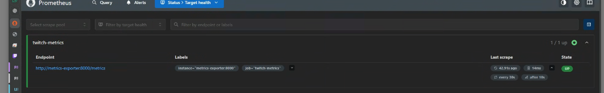
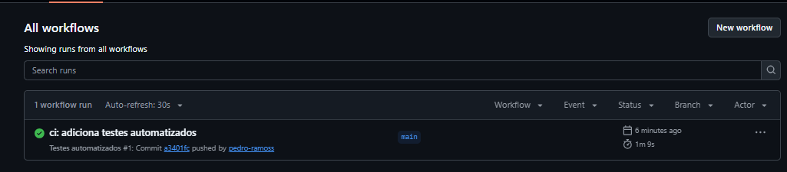

# Twitch Streaming — pipeline de dados com Kafka, PySpark e PostgreSQL


> Um projeto de Engenharia de Dados que coleta transmissões da Twitch, transporta os eventos pelo Kafka, trata os dados com PySpark e os disponibiliza no PostgreSQL e em dashboards Grafana.

**[Ver o código](https://github.com/pedro-ramoss/twitch-streaming)** · **[Ver os testes automatizados](https://github.com/pedro-ramoss/twitch-streaming/actions)**

## Por que fiz este projeto

Eu queria sair de um exercício isolado de API ou SQL e entender o que acontece **entre a chegada de um dado e a sua utilização**. A Twitch foi uma boa escolha porque os dados mudam de verdade: uma live começa, o número de espectadores cresce ou diminui, o jogo em destaque muda.

O objetivo não era só salvar um JSON no banco. Era montar um fluxo completo e lidar com problemas que aparecem no caminho: autenticação, indisponibilidade da API, dados inválidos, duplicidade, reprocessamento, logs, testes e monitoramento.

O projeto usa tecnologias de streaming, mas **a ingestão é agendada a cada seis horas** para respeitar o escopo e o custo do laboratório. Não é um serviço de coleta contínua em tempo real nem uma implantação em nuvem.

## O que já funciona

Os seguintes resultados foram observados no ambiente local (**Windows 11 + WSL2 + Docker Desktop**, em **29/10/2026**):

| Evidência | Resultado observado |
|---|---:|
| Registros na tabela `stream_snapshots` após a última execução manual | **265** |
| Novos registros inseridos na última execução ponta a ponta | **25** |
| Registros processados novamente no teste de idempotência | **215** |
| Duplicatas inseridas nesse reprocessamento | **0** |
| Suíte de testes do DE-016 | **32 aprovados, 1 ignorado** |
| GitHub Actions | **Execução com sucesso** |
| Agendamento no Windows | **Configurado para 00h, 06h, 12h e 18h** |

O primeiro painel Grafana, capturado quando havia **240 snapshots**, também mostrou **76 canais distintos**, **36 jogos distintos** e **244 mil espectadores na maior audiência registrada**. Esses números representam uma fotografia da base naquele momento; não são contadores em tempo real nem o resultado da operação de sete dias.



<details>
<summary>Outros gráficos e monitoramento</summary>

**Jogos observados nas coletas**



**Saúde do pipeline**



</details>

## Arquitetura



A tarefa do Windows aciona uma execução de coleta e processamento a cada seis horas, desde que o computador esteja acordado e o Docker Desktop disponível.

### O papel de cada tecnologia

| Tecnologia | Por que está aqui |
|---|---|
| **Python + Twitch Helix** | Autenticação, extração e organização dos eventos |
| **Apache Kafka** | Desacoplar quem coleta dos processos que consomem os eventos |
| **PySpark Structured Streaming** | Interpretar o JSON, aplicar regras e processar lotes de eventos |
| **Parquet** | Guardar dados válidos e rejeitados de forma estruturada, para auditoria/reprocessamento |
| **PostgreSQL** | Consultas SQL e histórico de snapshots de transmissões |
| **Docker Compose** | Executar Kafka, PostgreSQL e os serviços de monitoramento localmente |
| **pytest + GitHub Actions** | Verificar regras e executar a suíte automaticamente no GitHub |
| **Prometheus + Alertmanager** | Coletar métricas e apresentar alertas técnicos |
| **Grafana** | Visualizar a operação do pipeline e os dados de negócio |

## Como os dados são tratados

**1. Coleta.** O cliente acessa a API Helix com token, solicita até 25 transmissões e cria um evento contendo informações da stream e da coleta. Os JSONs brutos ficam disponíveis no histórico local.

**2. Transporte.** O producer publica os eventos no tópico `twitch-streams` do Kafka. O Spark lê esse tópico usando Structured Streaming.

**3. Qualidade.** Campos obrigatórios e valores inválidos, como espectadores negativos, são verificados. O que passa segue para a camada Silver em Parquet; o que não passa vai para a quarentena com informações que ajudam na investigação.

**4. Persistência.** O PostgreSQL recebe os snapshots com `event_id`, dados da transmissão, data da observação e `raw_data` em JSONB. Uma mesma live pode aparecer em mais de uma coleta: **snapshot não significa transmissão única**.

**5. Reprocessamento.** O checkpoint do Spark guarda o avanço do consumo; no banco, `ON CONFLICT (event_id) DO NOTHING` impede a reinserção do mesmo evento. Isso foi verificado ao reprocessar 215 registros e inserir zero duplicatas.

**6. Monitoramento.** Logs JSONL alimentam um Metrics Exporter, que disponibiliza contadores e durações ao Prometheus. O Grafana também consulta diretamente o PostgreSQL para os painéis analíticos.

<details>
<summary>Verificação real do alvo Prometheus</summary>



</details>

## Qualidade e confiabilidade

O projeto cobre com testes e validações os seguintes comportamentos:

- Tratamento de respostas da API, incluindo erros e tentativas de recuperação.
- Validação de registros e encaminhamento para quarentena.
- Escrita no PostgreSQL com controle de duplicatas.
- Falhas simuladas com mocks, fixtures e parametrização no pytest.
- Configuração do Grafana, métricas, benchmark e agendamento.

Os testes rodam localmente com `python -m pytest -q tests/` e, no repositório, também por **GitHub Actions** após um `push` ou `pull_request`. O resultado de **32 aprovados e 1 ignorado** refere-se à suíte-base verificada no DE-016; outros testes foram acrescentados nas etapas seguintes.



## Benchmark: o que foi medido de verdade

No benchmark local de **27/10/2026**, com a base ainda pequena:

| Medição | Resultado | Amostra/limite |
|---|---:|---|
| Ingestão, duração mediana histórica | **0,952 s** | 4 execuções bem-sucedidas |
| Lotes Spark, duração mediana histórica | **7,089 s** | 2 lotes bem-sucedidos |
| Escrita PostgreSQL, mediana nos logs | **0,591 s** | 1 observação |
| Consultas SQL, latência cliente p50 | **0,410–0,584 ms** | 240 snapshots naquele momento |
| Leitura offline de Parquet | **~1.330 registros/s** | 240 linhas, não é throughput ponta a ponta |

O relatório é reproduzível com `python -m scripts.benchmark` e é gerado em `reports/benchmarks/`. Não identifiquei motivo para aplicar índices ou aumentar o paralelismo agora: com poucas centenas de registros, parte relevante do tempo pode ser apenas overhead de execução e aquecimento do Spark.

## Executar localmente

**Ambiente utilizado:** Ubuntu no WSL2, Java 17, Python com venv, Docker Desktop e Docker Compose. É necessário cadastrar um aplicativo no [Twitch Developer Console](https://dev.twitch.tv/console/apps).

Na raiz do projeto, configure um arquivo `.env` **somente local** com os valores necessários:

```dotenv
TWITCH_CLIENT_ID=seu_client_id
TWITCH_CLIENT_SECRET=seu_client_secret
POSTGRES_PASSWORD=sua_senha_local
GRAFANA_ADMIN_PASSWORD=defina_uma_senha_local
```

Suba os serviços:

```bash
docker compose -f compose.yaml -f docker-compose.monitoring.yml -f docker-compose.grafana.yml up -d --build
```

Ative o ambiente Python e instale as dependências do projeto (incluindo PySpark, cliente Kafka e psycopg conforme o ambiente usado):

```bash
source venv/bin/activate
python -m pip install -r requirements.txt -r requirements-monitoring.txt
python -m pip install 'pyspark==4.2.0' 'kafka-python>=2.2,<3' 'psycopg[binary]>=3.2,<4'
```

Faça uma execução ponta a ponta:

```bash
python -m scripts.run_pipeline_once
```

Teste as funcionalidades:

```bash
python -m pytest -q tests/
```

Para ativar a tarefa no **Agendador do Windows** através do WSL:

```bash
bash scripts/enable_schedule.sh
```

Para pausá-la:

```bash
bash scripts/disable_schedule.sh
```

**Interfaces locais:** Grafana em `http://localhost:3000`, Prometheus em `http://localhost:9090`, Alertmanager em `http://localhost:9093`.

> Atenção: o ambiente descrito é um laboratório local. Não publique o `.env`, credenciais, snapshots brutos ou dados locais desnecessários. Evite `docker compose down -v`, pois isso remove os volumes de dados.

## Operação programada: acompanhamento de sete dias

O agendamento foi criado em **29/10/2026**, e uma execução manual ponta a ponta foi concluída com **25 novos registros**. Isso **ainda não demonstra sete dias de operação automática**.

<!-- 7D_START -->
**Em acompanhamento.** Estão previstas até **28 janelas** em sete dias (quatro por dia). O número real de execuções, sucessos, falhas, horários perdidos e novos registros será preenchido com base em `logs/scheduler_runs.jsonl`, sem projetar resultados.
<!-- 7D_END -->

Após a janela de observação, rode:

```bash
python -m scripts.report_7d
python -m scripts.atualizar_readme
```

O primeiro comando cria `reports/operations/relatorio_ultimos_7_dias.md`; o segundo atualiza apenas o bloco acima com as execuções registradas. É importante comparar a auditoria com os horários efetivamente agendados: PC desligado ou suspenso pode criar uma janela perdida sem deixar registro de execução.

## Limitações e próximos passos

- O agendamento depende de **Windows ligado, WSL disponível e Docker Desktop em execução**. Ainda não é uma implantação autônoma 24/7.
- O volume é intencionalmente pequeno: **até 25 streams por coleta, quatro coletas previstas por dia**. É um projeto de aprendizado, não um teste de carga industrial.
- Há um teste opcional de integração com PostgreSQL que foi ignorado na suíte-base; ampliar os testes com serviços reais é uma melhoria importante.
- O monitoramento atual usa logs JSONL como fonte para parte dos contadores. Preservar e rotacionar esses logs faz diferença na precisão histórica.
- Backup, gestão de segredos e operação fora do computador local seriam os próximos passos para uma instalação mais robusta.

## O que aprendi

A parte mais útil deste projeto não foi escrever um `producer` ou uma consulta SQL isolada. Foi entender por que **um pipeline pode parecer saudável em uma etapa e falhar em outra**. Tive que lidar com contêineres que não iniciavam, configurações de portas, montagem de arquivos no Docker, diferenças entre testes simulados e execução real, dados repetidos e métricas que apareciam zeradas apesar de o banco ter registros.

Esses problemas mudaram a forma como penso em Engenharia de Dados: o trabalho não termina quando a informação chega ao banco. Preciso saber **como ela chegou, como validar, como recuperar uma falha e como demonstrar que o processo continua funcionando**.

---

**Projeto de portfólio desenvolvido por Pedro Henrique** · [GitHub](https://github.com/pedro-ramoss) · Dados de referência: **29/10/2026**
